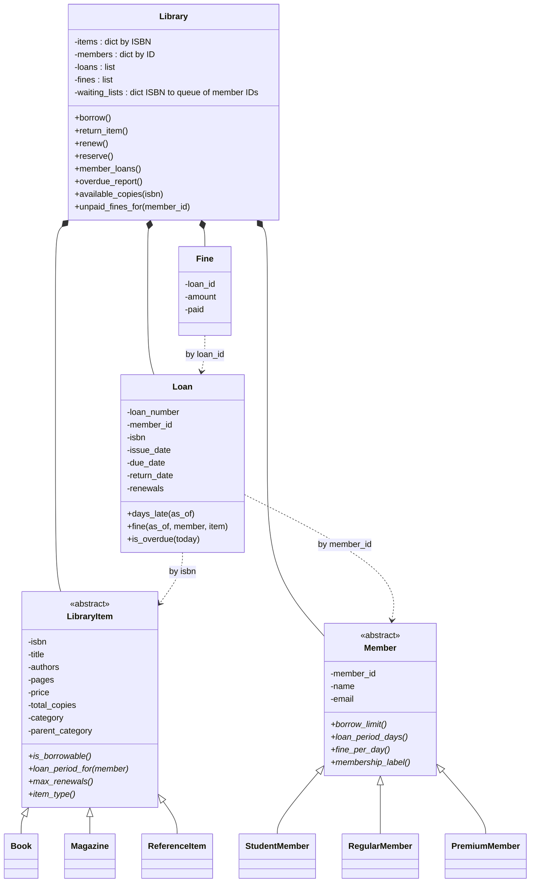

# LibraryHub Mini: Step 1 design notes (task 1.1, final)

Decisions D1 to D3 referred to here are in `DECISIONS.md`.

## 1. Candidates from the Rulebook

| Nouns (candidate classes / attributes) | Verbs (candidate methods) |
|---|---|
| library, catalogue | borrow |
| item, book, magazine, reference item | return |
| member, student, regular, premium, membership | renew |
| loan, issue date, due date, return date | reserve (join the waiting list) |
| loan period, borrow limit, fine rate | serve the first in the waiting list |
| fine, paid / unpaid | read in the library (not a loan) |
| copy, total copies, availability | calculate fine |
| ISBN, title, authors, pages, price | count days late |
| category, parent category | validate ISBN |
| waiting list | load data |
| renewal (count) | list items |
| member ID, name, email | report overdue |
| loan number | record an audit entry |
| today | |

## 2. Class diagram

## 3. Relationships (one defence each)

| Relationship | Type | Defence |
|---|---|---|
| Book / Magazine / ReferenceItem -> LibraryItem | is-a | Each one *is* a library item and answers the same questions (borrowable? how many days? renewable?) with different values. |
| Student / Regular / Premium -> Member | is-a | Each one *is* a member and answers the same questions (limit, days, fine rate, label) with different values. |
| Library has items, members, loans, fines, waiting lists | has-a (composition) | The library owns and manages these collections, and without the library they have no home. |
| Loan refers to a Member and a LibraryItem | association by ID (D3) | A loan *links* one member to one item and is not a kind of either. It stores `member_id` and `isbn`, so the library's dicts stay the single source of truth. |
| Fine refers to a Loan | association by ID (D1) | A fine is a record about one loan. It stores `loan_id` and a `paid` flag, and totals are calculated, never stored. |

## 4. What the abstract classes force subclasses to answer

**LibraryItem** (each item type answers):
- `is_borrowable()`: Book yes, Magazine yes, ReferenceItem no (R1)
- `loan_period_for(member)`: Book returns `member.loan_period_days()`, Magazine returns 7 whatever the member (R2)
- `max_renewals()`: Book 2 (R6), Magazine 0 (R2), ReferenceItem 0
- `item_type()`: "Book", "Magazine" or "Reference" (the `item_type` column in `books.csv`)

`category` and `parent_category` (for example Programming under Technology) are plain data on every item, not abstract questions. They are different from `item_type`.

**Member** (each member type answers, as methods):
- `borrow_limit()`: 3 / 5 / 10 (R3)
- `loan_period_days()`: 14 / 21 / 30
- `fine_per_day()`: 2 / 5 / 3 (R5)
- `membership_label()`: "Student" / "Regular" / "Premium", used by option 7, for example `Student: 3 items, 14 days, ₹2/day`

"A student's loan is 14 days" lives in `StudentMember`. "Magazines are 7 days" lives in `Magazine`. `Library.borrow()` never checks the member type, it just asks.

## 5. Plain data needed later

- `authors` is a list (the CSV separates several authors with `;`).
- `pages` feeds the Phase 2 catalogue sort and the two-sum challenge.
- `parent_category` feeds the category tree.

## 6. Traceability table (copy into README)

### Where each rule will live (design plan, not for the README)

| Rule | Method that enforces it |
|---|---|
| R1 | `ReferenceItem.is_borrowable()`, checked in `Library.borrow()` |
| R2 | `Magazine.loan_period_for()` and `Magazine.max_renewals()`, checked in `Library.renew()` |
| R3 | `Member.borrow_limit()` (subclasses), compared with the member's open loans in `Library.borrow()` |
| R4 | `Library.unpaid_fines_for(member_id)` adds up unpaid `Fine` records (D1), compared with ₹100 in `Library.borrow()` |
| R5 | `Loan.fine(as_of, member, item)` = min(days late × `member.fine_per_day()`, `item.price`) |
| R6 | `Library.renew()` using `Loan.renewals`, `item.max_renewals()`, `member.loan_period_days()` and the waiting list |
| R7 | `Library.reserve()` with one FIFO queue per ISBN; availability from `Library.available_copies(isbn)` (D2) |
| R8 | `Library.borrow()` scans the member's open loans for the same ISBN |
| R9 | `LibraryItem.isbn` setter plus the unique dict key in `Library` |
| R10 | `Loan.days_late(as_of)` returns `max(0, (as_of - due_date).days)` |

## 7. Changes made after review

- Added `authors`, `pages`, `category`, `parent_category` to `LibraryItem`. The old abstract `category()` is replaced by `item_type()`, so "category" now only means the data value.
- Removed `unpaid_fines` from `Member`. Added the `Fine` record (D1). Karthik must come out at ₹120.
- Added `membership_label()` to `Member`.
- Availability is calculated by `Library.available_copies(isbn)` (D2).
- `Loan` holds `member_id` and `isbn` (D3), so fine calculation receives the member and item.
- Library relationships are now composition (`*--`), and the member questions are methods with parentheses, as the brief says (changed in Step 3, see D5).

Quick check: no `if member_type` anywhere, and every rule R1 to R10 has a home.