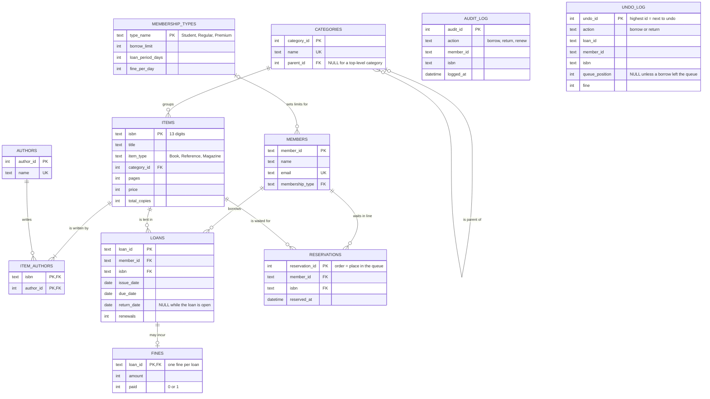

# ER diagram (draft)

Drawn with Mermaid (dbdiagram.io is not available on my work laptop). GitHub and
the VS Code Markdown preview draw it from the text below.

## How to read the lines

| Symbol | Meaning |
|---|---|
| `\|\|` | exactly one |
| `\|o` / `o\|` | zero or one |
| `o{` | zero or many |
| `\|{` | one or many |

Example: `MEMBERS ||--o{ LOANS` means one member has zero or many loans, and every
loan belongs to exactly one member.

## Cardinality of every relationship

| Relationship | Reads as |
|---|---|
| membership_types to members | a type has zero or many members, a member has exactly one type |
| categories to categories | a category has zero or many children and at most one parent |
| categories to items | a category groups zero or many items, an item has exactly one category |
| items to item_authors | an item has one or many author links |
| authors to item_authors | an author has zero or many author links (many-to-many with items) |
| members to loans | a member has zero or many loans, a loan has exactly one member |
| items to loans | an item is in zero or many loans, a loan has exactly one item |
| loans to fines | a loan has zero or one fine |
| members to reservations | a member has zero or many reservations |
| items to reservations | an item has zero or many reservations |

## Notes

- Availability is calculated, not stored (D1), so `ITEMS` has no `available_copies`.
- Every foreign key is `ON DELETE RESTRICT` (D2).
- `RESERVATIONS` and `UNDO_LOG` exist because the waiting list and undo history
  survive a restart (D4).
- `AUDIT_LOG` and `UNDO_LOG` have no foreign keys on purpose: a log must still be
  readable after what it describes has changed.
- This is a draft. Step 2 (normalisation) and Step 3 (`schema.sql`) may rename or
  move columns, and this diagram must be updated to match.